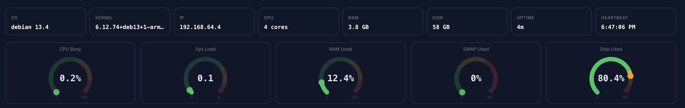

# Rework on the server detail page
## header

- OS:
    if os is too old and not in TLS -- display red and also an explication when user hovers
    if there is newer os version -- display orange and explain when user hovers
- Kernel: should display in full when user hovers
- Uptime: it's the uptime of server not uptime of sc-agent inside the server
## body
- CPU usage:
    should be more professional: more detail pour cpu usage like grafana
- Memory usage: 
    should be like grafana details
- Disk uage: 
    should be like grafana details
- Load average:
    should be like grafana details
- Disk i/o:
    should be like grafana
- Network Throughput
    should be like grafana
## security part
should move the security part to another page, user can access to it easily from dashboard or this detail page